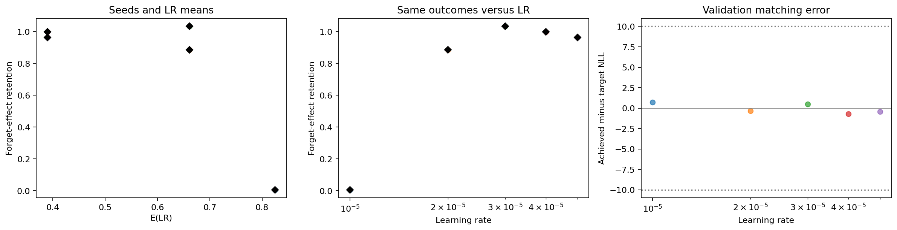
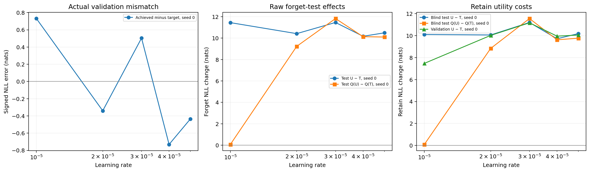
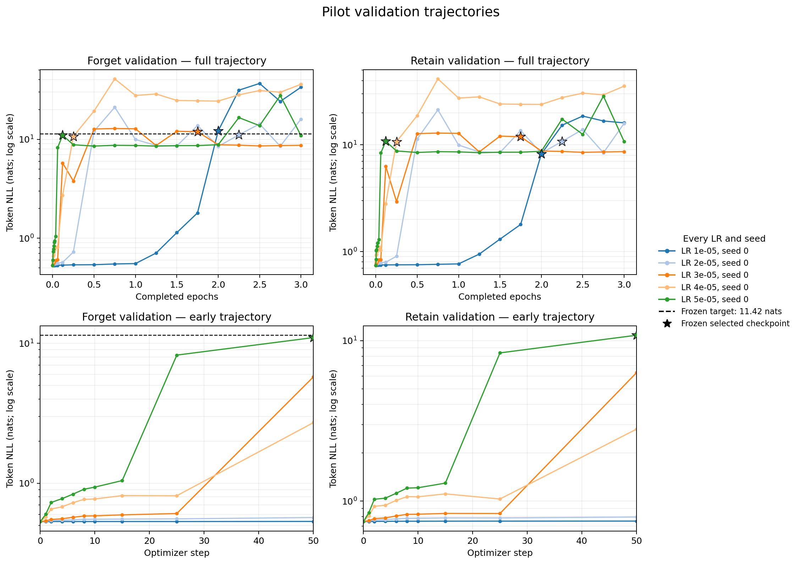

# Learning rate and unlearning retention

This experiment asks whether **E(lr)**, a simple check of how model weights respond to rounding, predicts how much forgetting survives model compression. This repository contains the completed MUSE-News experiment, its code, saved data, measurements and reports.

## Background

A model stores what it has learned in numbers called weights. Unlearning adjusts those weights to reduce the model's ability to reproduce selected training data while preserving its other capabilities. Quantization makes a model smaller by storing its weights with fewer bits, which rounds their values. [Zhang et al.](https://arxiv.org/abs/2410.16454) showed that this rounding can restore information a model appeared to have forgotten.

Rounding can also remove small weight changes during training. [Singh](https://arxiv.org/abs/2610.31859) studied this problem when weights are stored directly in BF16, a 16-bit number format, without a higher-precision FP32 copy to accumulate small changes. This gives us two stages to consider: changes can disappear during training, and the changes that remain can be rounded again during later quantization.

The learning rate, or LR, sets the scale of training changes. Whether a small change survives rounding also depends on the size of the weight and the precision used to store it. The same LR can therefore affect different models differently. Singh's E(u) captures some of this context by estimating how many weights would remain unchanged after a trial change of size u.

Our hypothesis is that lower E will correspond to more forgetting surviving later FP4 quantization. This extends Singh's work on training precision to unlearning and model compression. The training algorithm can make individual changes larger or smaller than the LR, so E is only a rough indicator here. For fixed original weights and precision, E is still determined by LR. We therefore compare both predictors rather than assume E is better.

## Experiment

We start with the [MUSE-News](https://arxiv.org/abs/2407.06460) version of Llama-2-7B, a language model with seven billion parameters. We use a training method called GA_GDR. It tries to make the model worse at predicting the text we want forgotten and better at predicting the text we want retained. The exact model and data versions are recorded in [the configuration](configs/experiment.yaml).

For each LR, we select a saved model version, called a checkpoint, near a shared forgetting target. Selection uses validation data and is fixed before we inspect quantized results or the separate test data. We then compare the selected models before and after FP4 quantization, which stores the quantized weights with four bits.

| Setting | Completed run |
| --- | --- |
| Learning rates | 1e-5, 2e-5, 3e-5, 4e-5, 5e-5 |
| Training | Seed 0; 3 epochs; 1,248 updates per LR |
| Precision | BF16 weights and optimizer moments; no FP32 master copy |
| Checkpoints | Every 0.25 epochs plus early steps; 21 per LR, 105 total |
| Selection | Nearest forget-validation NLL to a shared target, frozen before quantized or test evaluation |
| Quantization | bitsandbytes FP4; 12 final evaluations across the original and five selected models |

NLL, or negative log-likelihood, measures how poorly a model predicts the next token, a small piece of text such as a word or part of a word. We report it in units called nats.

**Forget NLL** measures prediction error on the text we want forgotten; a higher value means worse prediction of that text and serves as our proxy for forgetting.

**Retain NLL** measures prediction error on the text we want the model to keep handling well; an increase over the original model signals damage to that performance.

Our main outcome is the fraction of the forgetting effect that remains after quantization:

```text
retention = [NLL(Q(U)) - NLL(Q(T))] / [NLL(U) - NLL(T)]
```

Here T is the original model, U is a selected unlearned model, and Q applies FP4 quantization. A retention value of 1 means the measured forgetting effect fully survives, while 0 means none of the NLL increase remains. Values above 1 are possible if that effect increases after quantization. Here, retention means survival of forgetting; retain NLL separately measures performance on the text the model should still handle well.

## Latest results

At LR **1e-5**, almost all of the measured forgetting disappeared after FP4 quantization: retention was **0.005956**. At the other four LRs, retention ranged from **0.885885 to 1.031947**, so most or all of the effect remained.

Lower E generally went with more forgetting surviving quantization. Two measures of association were negative for E: Pearson correlation was **-0.714**, and Spearman rank correlation was **-0.527**. Log learning rate had a larger absolute association, at **+0.870** and **+0.600**, respectively. These observations do not establish that E predicts new results better than LR alone.



These plots show the same five outcomes against E(lr) and learning rate. Each LR has only one training seed, so we cannot estimate variation across repeated runs. The five LRs also produce only three distinct E values.



The selected models differed from the shared forgetting target by up to **0.732 nats**, within the broad configured tolerance of 10 nats. Every selected unquantized model also increased retain-test NLL by **9.716-11.197 nats**, showing severe damage to predictions on retained text. The results therefore describe forgetting that accompanies a substantial loss of model performance; they do not demonstrate useful selective unlearning.



Stars mark the frozen selected checkpoints; the dashed line marks the shared forget-validation target. Higher NLL means worse prediction on the corresponding data.

Read the [full report](results/muse_news_bf16_lr_refinement_20261102T105346Z/postprocessing/final-report/report.md), [numerical overview](results/muse_news_bf16_lr_refinement_20261102T105346Z/postprocessing/final-report/overview.csv), or [interpretation and audit](results/muse_news_bf16_lr_refinement_20261102T105346Z/postprocessing/final-report/interpretation.md). The cloud setup suite passed **128 tests**.

## Usage

### 1. Inspect the completed experiment

Clone on your local machine with an account that has access to this private repository:

```bash
gh repo clone aidenhongg/lr-retention
cd lr-retention
```

The saved reports and graphs can be inspected without a GPU. The [timestamped results directory](results/muse_news_bf16_lr_refinement_20261102T105346Z/) includes all six frozen tokenized dataset splits and document-membership manifests, raw records, runtime logs, a source snapshot and the environment freeze.

### 2. Prepare RunPod for a new run

Run model computation and tests on a Linux GPU pod with BF16 support, Python 3.11 and CUDA 12.8. The completed sweep used **2 TB of temporary disk**; its ten selected/final checkpoint bundles require about **135 GB**, so allow sufficient free space on a persistent network volume mounted at `/workspace`.

Copy the checkout to `/opt/mock-experiment` on the pod. Give the new experiment a fresh name and output directory in `configs/experiment.yaml`. The pipeline downloads the pinned model and materializes the source documents before tokenization.

For CLI provisioning, inspect `python runpod/pod.py create --help` on your local machine, set `RUNPOD_KEY` in its environment, and pass `--disk-gb 2000`. Supply the persistent volume's ID and allocated size with `--network-volume` and `--network-volume-gb`. The helper saves ownership and budget settings to the path supplied with `--state`. Keep its budget guard running in another local terminal, using that same state path:

```bash
python runpod/pod.py guard --state runpod/new-run-state.json --poll 30
```

The helper defaults to a $15 ceiling and a $1 shutdown reserve. The guard enforces these limits while it is running.

### 3. Install dependencies and validate the pod

Run on the pod:

```bash
cd /opt/mock-experiment
bash runpod/setup.sh
source /opt/pilot-env/bin/activate
```

Setup installs pinned dependencies, checks CUDA/BF16 support and runs the test suite.

### 4. Train, select checkpoints and evaluate

Continue in the same pod shell. Use a fresh artifact directory for every experiment:

```bash
RUN_ID="muse_news_lr_$(date -u +%Y%m%dT%H%M%SZ)"
ARTIFACTS="/artifacts/$RUN_ID"
mkdir -p "$ARTIFACTS/runtime"
export MPLBACKEND=Agg
set -o pipefail

python -u -m src.experiments.sweep \
  --action all \
  --config configs/experiment.yaml \
  --root /opt/mock-experiment \
  --artifacts "$ARTIFACTS" \
  2>&1 | tee "$ARTIFACTS/runtime/experiment.log"
```

The pipeline trains each run, evaluates validation checkpoints, freezes selection, then performs test/FP4 evaluation and writes summaries and figures under `$ARTIFACTS/analysis/`. An unavailable matched comparison exits with code 2 and saves the available diagnostics. The log and immutable records preserve failures.

### 5. Archive weights, collect results and shut down

In the same pod shell, plan the archive and copy it to a fresh directory on the mounted network volume:

```bash
python runpod/archive.py plan --root "$ARTIFACTS"
python runpod/archive.py copy \
  --root "$ARTIFACTS" \
  --destination "/workspace/$RUN_ID"
```

Confirm the receipt reports `status: verified` and check its experiment status and missing/incomplete runs. Copy the small artifacts back into `results/$RUN_ID/`, excluding `checkpoints/`; preserve the source snapshot and environment freeze alongside them. After verifying the archive and local collection, terminate the pod. If it was created through the helper, run locally with the same state path:

```bash
python runpod/pod.py terminate --state runpod/new-run-state.json
python runpod/pod.py status --state runpod/new-run-state.json
```
