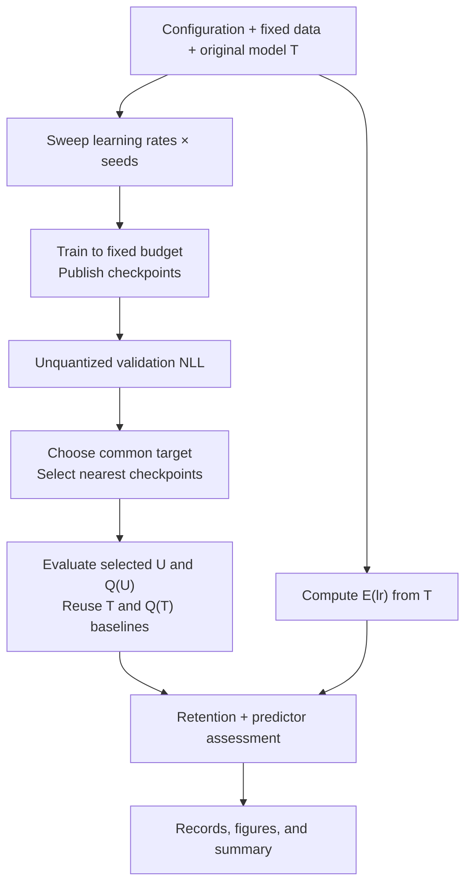

## **experiments**

Owns configuration and the two sweep stages. Related coordination functions stay in one module.

### • sweep

#### Functions

`load_config` — Read YAML, validate settings, and resolve input paths against the supplied project root.

- **Input:** `Path` config file and `Path` project root.
- **Output:** `ExperimentConfig` — validated recipe, sweep settings, and execution settings.

`run_sweep` — Save resolved settings and software versions, prepare fixed data, compute the predictor, train each LR/seed run, and collect unquantized validation measurements. Stop here so the target can be chosen from the curves.

- **Input:** `ExperimentConfig` and `Path` artifact root.
- **Output:** `Path` saved `SweepIndex` — references to run outcomes, expected evaluation jobs, validation results, and predictor records; includes incomplete or failed status.

`finalize_sweep` — Apply the runtime target decision, save the selection, evaluate selected models and baselines, and produce the analysis. Do not proceed if the selection is unavailable.

- **Input:** `Path` sweep index, `Path` local artifact root, and `SelectionDecision` — target and acceptable mismatch chosen from validation results.
- **Output:** `AnalysisResult` — completion status and references to selection, measurements, tables, and figures.

## **training**

Owns model updates, optimizer state, and checkpoint creation. Every run starts from the same original weights.

### • unlearn

#### Functions

`train_run` — Set the run seed, load its original model and training data, apply the configured unlearning recipe, and save scheduled and final checkpoints. Release model and optimizer resources when finished.

- **Input:** `RunSpec`, `Path` local artifact root, and `Callable[[CheckpointRef], None]` — callback invoked after each checkpoint is complete.
- **Output:** `RunResult` — status, checkpoint references, last step, and any failure reason.

The callback publishes jobs without waiting for evaluation. If publication fails, retain the saved checkpoint in `RunResult` so the coordinator can republish its job. Use the configured GA plus retain-loss recipe and precision settings; reject unsupported settings instead of silently changing them.

## **eval**

Owns model loading for inference, quantization, NLL measurement, and evaluation jobs. These operations share one module and one model lifecycle.

### • evaluator

#### Functions

`load_model` — Load original or checkpoint weights with explicit dtype and device settings. Quantized loading also applies the configured compute and non-quantized-module dtypes. For bitsandbytes, pass quantization settings during loading, as in the [Transformers API](https://huggingface.co/docs/transformers/quantization/bitsandbytes).

- **Input:** `ModelRef`, inference/quantization settings, `str` local device, and `Path` local artifact root.
- **Output:** `PreTrainedModel` — loaded original or quantized model, ready for inference.

`measure_nll` — Evaluate without gradients and sum next-token NLL over valid target tokens using attention/label masks. Exclude padding and the unpredicted first token; restore the caller's model mode afterward.

- **Input:** `PreTrainedModel`, `Dataset`, and `int` batch size.
- **Output:** `NLLStats` — NLL sum and target-token count; mean NLL is sum divided by count.

`evaluate` — Load one model variant, measure every requested split while it is loaded, then release it. A job completes only when every requested split succeeds.

- **Input:** `EvaluationRequest`, `str` local device, and `Path` local artifact root.
- **Output:** `EvaluationResult` — job status, per-split NLL statistics, or failure details.

`run_worker` — Read ready jobs from the artifact directory, call `evaluate`, and publish results.

- **Input:** `Path` local artifact root and `str` local device.
- **Output:** Published `EvaluationResult` records; the process runs until stopped.

## **analysis**

Owns checkpoint matching and numerical analysis. It receives measurement records, not loaded models or a mutable coordinator object.

### • selection

#### Functions

`select_checkpoints` — Find the nearest saved checkpoint to the chosen target for every expected run; break ties by earliest step. Check observed support and the chosen mismatch limit, and report signed error as achieved NLL minus target NLL.

- **Input:** Expected `list[RunSpec]`, `list[CheckpointRef]`, unquantized validation `list[EvaluationResult]` including T, `SelectionDecision`, completed `list[RunResult]`, and expected validation job IDs.
- **Output:** `SelectionResult` — decision, selected checkpoint references, achieved NLLs, signed errors, and unavailable-match reasons.

Choose a finite target above T's forget-validation NLL and a finite, nonnegative mismatch limit at experiment time. Check each selected checkpoint's gain over T as well as its target error. Use no quantized results, blind tests, or predictor agreement. An overlapping range does not guarantee a close saved checkpoint; do not interpolate weights or silently omit runs.

### • metrics

#### Functions

`compute_predictor` — Compute E(lr): the fraction of original linear weights unchanged in both directions after adding/subtracting lr in a wider working dtype and rounding once to training storage precision. Compare with T in that same storage precision without modifying T. Record tensor scope and precision; this is an erasure estimate, not an exact AdamW guarantee.

- **Input:** `ModelRef`, `list[float]` learning rates, training precision settings, and `Path` local artifact root.
- **Output:** `list[PredictorResult]` — LR/value records with model and calculation identities.

`measure_retention` — Join baseline and selected-model measurements by dataset and evaluation settings. Report forget-effect retention and retain-NLL changes separately.

- **Input:** `SelectionResult`, matching T, Q(T), U, Q(U) `list[EvaluationResult]`, and an optional numerical denominator floor, which defaults to `1e-8` nats.
- **Output:** `list[RetentionResult]` — raw NLLs, forget-effect gaps, retention ratios, retain-NLL changes, and validity status.

`assess_predictor` — Compare E(lr) with retention across learning rates, showing seed variation and matching errors. Write the summary table and figures.

- **Input:** `list[PredictorResult]`, `list[RetentionResult]`, `SelectionResult`, and `Path` output directory.
- **Output:** `AnalysisResult` — assessment and output locations.

## Shared modules

### • inputs

Owns fixed dataset preparation and loading for both training and evaluation.

#### Functions

`prepare_data` — Load the pinned tokenizer, tokenize configured split files consistently, and save fixed sample manifests and preprocessing metadata. Verify tokenizer identities against the model. Do not split randomly inside a run; validation and test documents must be disjoint from unlearning training data.

- **Input:** `ExperimentConfig` and `Path` artifact root.
- **Output:** `dict[str, DatasetRef]` — forget/retain training, validation, and test datasets.

`load_data` — Open a prepared dataset with its saved tokenization and masks.

- **Input:** `DatasetRef` and `Path` local artifact root.
- **Output:** `Dataset` — tokenized samples with input IDs, attention masks, and target labels.

### • artifacts

Defines the small records below and their JSON read/write helpers. Model weights and tokenized data remain separate files; model objects and tensors never enter job records.

#### Functions

`publish_record` — Write a record to a temporary file and rename it when complete. Records are immutable; identical writes are harmless and conflicting writes are errors. Index updates use new snapshots, and job retries use new attempt IDs.

- **Input:** Typed record and `Path` local artifact root.
- **Output:** `Path` completed record.

`read_record` — Read and validate a published record's type and schema version.

- **Input:** `Path` completed record.
- **Output:** Typed record, or an explicit read/validation error.

## Shared interface types

Records are small dataclasses. Persistent records include their kind and schema version. Settings reuse the config's named sections rather than introducing a generic options bag.

| Type | Contents |
|---|---|
| `ExperimentConfig` | Resolved recipe, LR/seed grid, model/tokenizer references, dataset locations, validation interval, and execution settings. |
| `ModelRef` | Stable model ID, immutable weight location/revision, tokenizer identity, and storage precision. |
| `DatasetRef` | Dataset ID, location, split, sample-manifest reference, tokenizer/preprocessing identity, and tokenization settings. |
| `RunSpec` | Run ID, LR, seed, original `ModelRef`, training `DatasetRef`s, training settings, checkpoint schedule, and output location. |
| `CheckpointRef` | `model: ModelRef`, run ID, completed optimizer step, and epoch. Loading uses its `model` reference. |
| `RunResult` | Run ID, success/failure status, checkpoint references, last step, and failure reason. |
| `EvaluationRequest` | Logical job ID, attempt ID, model reference, dataset references, original/quantized variant, evaluation settings, and settings identity. |
| `NLLStats` | NLL sum and valid target-token count; zero tokens is an error. |
| `EvaluationResult` | Job/attempt/model/settings identities, actual inference/compute precision and software versions, completion/failure status, per-dataset `NLLStats`, and any failure reason. |
| `PredictorResult` | LR, E(lr), original model identity, tensor scope, and rounding precision. |
| `SweepIndex` | Snapshot ID, config and data references, expected run/job IDs, result locations, predictor location, and stage status. |
| `SelectionDecision` | Runtime target NLL, accepted maximum absolute matching error, and a short reason for the choice. |
| `SelectionResult` | Availability status, saved decision, run/LR/seed and checkpoint for each selection, achieved validation NLLs and gains over T, signed errors, and failure reasons. |
| `RetentionResult` | Run/LR/seed, dataset/settings identities, raw NLLs, gaps, ratio, retain-NLL changes, and validity status. |
| `AnalysisResult` | Status and locations of selection, measurements, summary tables, and figures. |

## Execution rules

- **Start consistently:** freeze model/tokenizer revisions, data membership, preprocessing, resolved config, and software versions. Record effective batch size and actual precision settings. Reset model, optimizer, and random state for each run.
- **Use a fixed budget:** choose checkpoint steps from the configured positive epoch interval, rounded up to whole optimizer steps and at least one step. Save the final checkpoint once even if it falls on a scheduled step. Validation does not stop training.
- **Publish complete artifacts:** save checkpoint files first, then publish their reference and evaluation job. References use paths relative to the shared artifact root or pinned external sources; each machine resolves its own local root.
- **Keep ownership simple:** training owns checkpoints; the coordinator owns scheduling and evaluation retries; the evaluator owns result records; analysis owns selection and reports. A ready job ID covers the model/checkpoint, data, tokenizer, variant, and evaluation settings.
- **Track completion explicitly:** require a successful outcome for every expected run and validation job before selection. An empty queue is not completion. Bound waits and report missing, failed, or unfinished work. Keep immutable per-attempt results; reuse a successful attempt for each logical job and count it once. Reconcile saved checkpoints against jobs after publication failures.
- **Separate selection from testing:** first collect original-model and checkpoint validation NLL. Choose a target with meaningful forgetting from the observed curves, record acceptable mismatch, and freeze the selection. Then evaluate selected U/Q(U) and T/Q(T) on the fixed tests. Matching validation NLL does not guarantee matching test NLL or retain utility.
- **Reuse compatible baselines:** evaluate T and Q(T) once per dataset/tokenization and model/inference/quantization settings combination. Reject results whose data, tokenizer, or actual precision settings differ from the request.
- **Keep the measurements honest:** use token-weighted NLL in nats. On the same forget split, retention is `(NLL(Q(U)) - NLL(Q(T))) / (NLL(U) - NLL(T))`. Nonfinite denominators and gaps at or below the numerical floor are invalid; preserve the raw gap so near-zero effects remain visible. Do not clamp ratios to zero or one. Summarize seed variation within each LR rather than counting seeds as additional LR settings.
- **Preserve evidence:** keep checkpoint references, curves, decisions, failures, and raw measurements. Delete unselected weights only after their jobs finish and final analysis is complete; retain selected and final checkpoints.

## Two-machine execution

`execution.parallel_eval_on_separate_machine` uses one training machine and one evaluation machine. Start `run_worker` on the second machine; the harness does not provision it. Training publishes complete checkpoints and continues while the evaluator processes jobs. Both machines need the same artifacts through shared storage or file transfer; transfer must finish before a job becomes ready. This can reduce elapsed time but adds machine and transfer cost.

With the option off, finish one training run, release its model and optimizer, and evaluate its saved checkpoints locally before the next run. Both modes use the same checkpoint schedule, evaluation code, records, and selection rules. Simple functions and artifact files are sufficient; no broker, transport framework, or worker class is needed.
