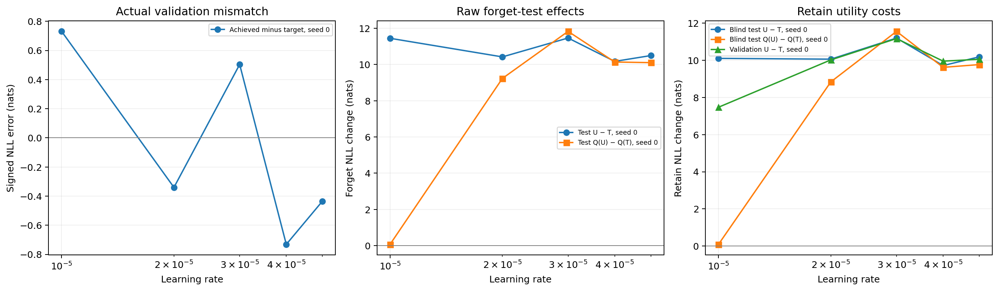

# Refinement result: available under the saved tolerance

Frozen selection status: **complete**. Final analysis status: **complete**. Recorded valid retention results: 5 of 5 runs.

The accepted maximum absolute validation mismatch was **10 nats**. A tolerance of 10 nats is broad: acceptance under this rule does not substantiate close matching. Actual errors, gains, and selected steps are shown below. Differences in achieved forgetting can confound the predictor comparison.

The frozen target was 11.424177 nats; the minimum gain over T was 0.25 nats. Original forget-validation NLL was 0.53210093 nats. Recorded common-range bounds: [0.6002463226586467, 12.864628261157385]. If the lower bound exceeds the upper bound, the intersection is empty; those bounds are not a feasible interval.

| LR | Seed | E(LR) | Step | Achieved validation NLL | Gain over T | Signed error | Run status |
| --- | --- | --- | --- | --- | --- | --- | --- |
| 1e-05 | 0 | 0.82471901 | 832 | 12.155435 | 11.623334 | 0.73125788 | complete |
| 2e-05 | 0 | 0.66099565 | 936 | 11.084067 | 10.551966 | -0.34011091 | complete |
| 3e-05 | 0 | 0.66099565 | 728 | 11.928333 | 11.396232 | 0.5041553 | complete |
| 4e-05 | 0 | 0.38965346 | 104 | 10.69292 | 10.160819 | -0.73125788 | complete |
| 5e-05 | 0 | 0.38965346 | 50 | 10.989719 | 10.457618 | -0.43445831 | complete |

Errors are achieved minus target NLL; all NLLs and NLL changes use nats. CSV values retain full numerical precision. If global selection is unavailable, any populated checkpoint fields are recorded candidates, not a completed matched selection.

## Raw blind-test forgetting and retention

Retention is (NLL(Q(U)) − NLL(Q(T))) / (NLL(U) − NLL(T)) on the same forget-test data. The existing analysis requires a finite denominator greater than 1e-08; nonpositive, tiny, or nonfinite effects are invalid. Ratios remain unclamped, including negative values and values above one. Unmeasured values are not zero.

| LR | Seed | T | Q(T) | U | Q(U) | U−T | Q(U)−Q(T) | Retention | Denominator | Record status |
| --- | --- | --- | --- | --- | --- | --- | --- | --- | --- | --- |
| 1e-05 | 0 | 0.4242827 | 0.49987691 | 11.874987 | 0.56807342 | 11.450704 | 0.068196512 | 0.0059556611 | valid | complete |
| 2e-05 | 0 | 0.4242827 | 0.49987691 | 10.847013 | 9.7332143 | 10.42273 | 9.2333374 | 0.88588474 | valid | complete |
| 3e-05 | 0 | 0.4242827 | 0.49987691 | 11.890884 | 12.332804 | 11.466602 | 11.832927 | 1.0319472 | valid | complete |
| 4e-05 | 0 | 0.4242827 | 0.49987691 | 10.599212 | 10.640891 | 10.174929 | 10.141014 | 0.99666679 | valid | complete |
| 5e-05 | 0 | 0.4242827 | 0.49987691 | 10.921454 | 10.605441 | 10.497171 | 10.105564 | 0.96269403 | valid | complete |

## Utility: validation and blind tests are separate

Retain-validation NLL is a utility proxy used here to describe the selected checkpoint. Blind retain-test NLL is a separate final measurement. Positive changes indicate worse prediction; each quantized change uses Q(T) as its baseline. Neither split should be described as proving comprehensive retained capability.

| LR | Seed | Validation T | Validation U | Validation U−T | Test T | Test Q(T) | Test U | Test Q(U) | Test U−T | Test Q(U)−Q(T) |
| --- | --- | --- | --- | --- | --- | --- | --- | --- | --- | --- |
| 1e-05 | 0 | 0.7455722 | 8.2180315 | 7.4724593 | 0.69204205 | 0.77445724 | 10.795372 | 0.86507667 | 10.103329 | 0.090619428 |
| 2e-05 | 0 | 0.7455722 | 10.766576 | 10.021004 | 0.69204205 | 0.77445724 | 10.752954 | 9.6111202 | 10.060912 | 8.8366629 |
| 3e-05 | 0 | 0.7455722 | 11.915044 | 11.169472 | 0.69204205 | 0.77445724 | 11.88902 | 12.331404 | 11.196978 | 11.556947 |
| 4e-05 | 0 | 0.7455722 | 10.699652 | 9.9540798 | 0.69204205 | 0.77445724 | 10.408303 | 10.394388 | 9.7162613 | 9.6199308 |
| 5e-05 | 0 | 0.7455722 | 10.800024 | 10.054452 | 0.69204205 | 0.77445724 | 10.878293 | 10.543786 | 10.186251 | 9.7693284 |

## Training trajectories

Ranges below cover saved checkpoints, excluding original step zero. Final checkpoints do not replace the frozen selections.

| LR | Seed | Saved forget minimum | Saved forget maximum | First step | First forget NLL | Final forget NLL | Final retain NLL | Final step | Saved checkpoints |
| --- | --- | --- | --- | --- | --- | --- | --- | --- | --- |
| 1e-05 | 0 | 0.53213664 | 36.725664 | 1 | 0.53213664 | 33.638215 | 16.062207 | 1248 | 21 |
| 2e-05 | 0 | 0.53530073 | 21.098483 | 1 | 0.53530073 | 16.00555 | 15.890591 | 1248 | 21 |
| 3e-05 | 0 | 0.53798751 | 12.864628 | 1 | 0.53798751 | 8.6916341 | 8.6379657 | 1248 | 21 |
| 4e-05 | 0 | 0.57487128 | 40.841278 | 1 | 0.57487128 | 35.98943 | 35.46353 | 1248 | 21 |
| 5e-05 | 0 | 0.60024632 | 27.646844 | 1 | 0.60024632 | 10.899207 | 10.741624 | 1248 | 21 |

## Exploratory predictor comparison

The saved analysis reports 5 comparable learning-rate settings. The experiment uses one seed per LR, so seed variability cannot be estimated. Correlations below reproduce the saved LR-level seed-mean analysis; seeds are not counted as additional LR settings. Undefined or unavailable correlations are labeled explicitly.

| Predictor | Pearson with retention | Spearman with retention |
| --- | --- | --- |
| E(LR) | -0.71398822 | -0.52704628 |
| log10(LR) | 0.87042392 | 0.6 |

E(LR) is determined by LR and the original weights. These correlations do not show added predictive value beyond LR, establish causality, or overcome the broad validation mismatch allowance. Inspect raw test effect sizes, actual matching errors, and utility losses together. If selection is unavailable, the planned matched quantization comparison remains untested; missing retention entries describe unmeasured outcomes.

## Provenance and record checks

- Selection: `records/selection_result/13514939b9da090eafa9c7807bbfea2fa2933e9c2d452e263c8a30b79507f06e.json`.
- Final analysis: `records/analysis_result/dba92a1e6a13fa66b51dce185079beb1d5f84e2358400bd5edaef326f49e8e6d.json`; sweep snapshot: `records/sweep_index/c04494f269364ca39f9abaf939ae3143.json`.
- Model `muse-bench/MUSE-news_target` at `a2f39769e9a0b98ec1cdd12f65e9962502208935`; tokenizer `NousResearch/Llama-2-7b-hf` at `8efe6c9b93655b934e27bd9981e3ec13e55aee9d`.
- Data `muse-bench/MUSE-News` at `506bd5b150b92814d45e4404a82f120ab2d748bf`; split memberships and preprocessing remain in the dataset manifests.
- Configured storage `bfloat16`, optimizer moments `bfloat16`, FP32 master weights `False`; quantizer `{'backend': 'bitsandbytes', 'bnb_4bit_compute_dtype': 'float32', 'bnb_4bit_quant_type': 'fp4', 'bnb_4bit_use_double_quant': False, 'calibration_required': False, 'load_in_4bit': True, 'non_quantized_parameter_dtype': 'bfloat16'}`. Actual variant precision, software versions, data IDs and token counts are reproduced in `provenance.json`.
- E(LR) measures original linear weights unchanged in both perturbation directions after FP32 arithmetic and BF16 rounding; it is not an exact AdamW update guarantee.
- Arithmetic consistency issues: none found among available recorded values.
- `overview.csv` preserves every expected run, raw values, failure reasons, denominator validity, and separate validation/test utility costs.
- Existing test evidence `runtime/setup.log`: 128 passed, 360 warnings in 7.56s. No tests were run by this report helper.

Figure values are existing measurements; lines connect the same seed across LRs and do not imply additional samples.

This additive report changes no selection, scientific source, config, immutable record, or generated summary. It performs record aggregation only, with no model loading, training, quantization, evaluation, or cost/teardown claims.
